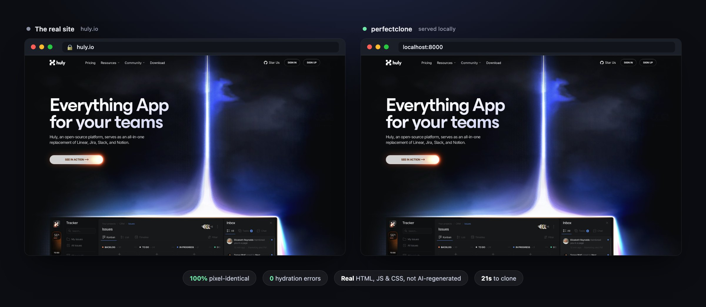
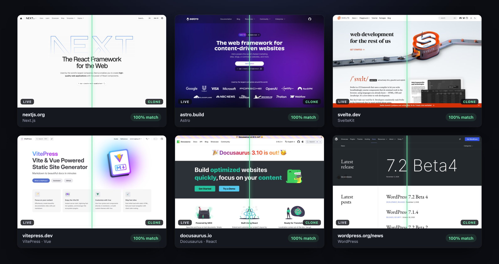

# perfectclone: website cloner that copies the real site, 1:1

**perfectclone clones any website 1:1.** It crawls the site with a real browser (Playwright),
downloads the site's own HTML, JavaScript, CSS, fonts and images, and gives you a folder you can
serve, edit and deploy. Then it lets you rebrand it, rehost it and strip the original owner's
trackers without breaking it, including Next.js sites that hydrate on load.



```bash
pip install git+https://github.com/eshaangulati123/perfectclone-website-cloner

perfectclone clone example.com
perfectclone serve example.com             # → http://localhost:8000
```

That's it. Chromium is downloaded automatically the first time you clone. Requires Python 3.10+.

## Why not an AI cloner?

Most "clone any website" tools today regenerate the site: an AI agent looks at screenshots or
scraped markup, writes a new React/Next.js app, and compares the result against the original
with a visual-similarity score until it's close enough. That gets you a lookalike. The code is
new, the behaviour is approximate, and there are always gaps.

perfectclone doesn't regenerate anything. It mirrors the bytes the site actually serves, so
the clone *is* the site: same markup, same bundles, same animations, same JavaScript running.
Sometimes the real solution is the simple one.

|                         | AI cloners                    | wget / HTTrack           | perfectclone                       |
| ----------------------- | ----------------------------- | ------------------------ | ---------------------------------- |
| Output                  | New code that looks similar   | Files linked from HTML   | The site's own files               |
| Fidelity                | Visual similarity score       | Breaks on JS-heavy sites | Byte-for-byte                      |
| Lazy JS chunks, fonts   | n/a (regenerated)             | Missed (no JS engine)    | Captured by a real browser         |
| Next.js / React hydration | n/a                         | Breaks                   | Works                              |
| Safe text / brand edits | Edit generated code           | Breaks hydration         | Payload-aware, hydration-safe      |
| Strip trackers          | n/a                           | Manual                   | Built in                           |
| Needs an LLM / API key  | Yes                           | No                       | No                                 |

**Prior art, credited.** Capturing a site byte-for-byte with a browser isn't new: web archiving
tools like [Webrecorder / Browsertrix](https://webrecorder.net/) and Playwright's HAR
record/replay do it for replay. perfectclone's focus is different: it turns the capture into an
ordinary folder of files you can edit and deploy anywhere, and it knows how to edit Next.js
pages without breaking them.

## Tested on real sites

Each card is one site split down the middle: the live site on the left, the clone on the right.



`scripts/compat.py` clones each site, serves the copy, and compares its home page with the live
one at 1440×900, with animations and videos paused on the same frame:

| Site | Built with | Pixel match | Hydration errors | Notes |
| --- | --- | --- | --- | --- |
| huly.io | Next.js | 100% | 0 | |
| nextjs.org | Next.js | 100% | 0 | |
| astro.build | Astro | 100% | 0 | |
| svelte.dev | SvelteKit | 100% | 0 | |
| vitepress.dev | VitePress (Vue) | 100% | 0 | |
| docusaurus.io | Docusaurus (React) | 100% | 0 | |
| wordpress.org/news | WordPress | 100% | 0 | |
| paulgraham.com | Hand-written HTML | 100% | 0 | |
| example.com | Static HTML | 100% | 0 | |
| framer.com | Framer | 96% | 0 | Cookie banner needs Framer's backend |
| webflow.com | Webflow | 93% | 0 | Cookie banner won't run on localhost; carousel caught mid-scroll |

Every clone loaded with zero requests to trackers. Run it yourself with
`python scripts/compat.py`, and please open an issue for any site that doesn't come out right.

## Commands

```bash
perfectclone clone <url> [-o out] [--max-pages 200] [--extract] [--keep-trackers] [--ignore-robots]
perfectclone serve <site> [-p 8000]
perfectclone replace <site> <old> <new> [--exact-case] [--substring]
perfectclone rehost <site> <old-origin> <new-origin>
perfectclone strip-trackers <site>
```

- **clone** writes `out/site/` (the working copy) and `out/manifest.json` (pages, failures,
  third-party hosts the site uses). `--extract` also saves each page's text, metadata
  (headings, links, images, forms, JSON-LD) and a full-page screenshot to `out/extract/`.
  Trackers are stripped by default.
- **replace** renames text everywhere: HTML, JS, CSS, JSON, SVG. It also handles the UPPER,
  lower and Capitalized variants, and leaves URLs and asset paths alone so nothing 404s.
- **rehost** points canonical, Open Graph, JSON-LD and sitemap URLs at your domain.
- **serve** works like a static host: clean URLs (`/about` → `/about/index.html`), and
  `/_next/image` requests are served from the mirrored originals.

Rebrand a clone and put it online:

```bash
perfectclone clone acme.com -o acme
perfectclone replace acme "Acme" "Globex"
perfectclone rehost  acme https://acme.com https://globex.com
npx netlify-cli deploy --dir acme/site --prod      # or any static host
```

## How it works

1. **Crawl with a real browser.** Each page is rendered in Chromium and scrolled to the bottom,
   and every response is recorded. That catches what static mirrors miss: code-split JS chunks,
   fonts requested from CSS, images behind lazy loading. Links are followed breadth-first,
   seeded from the sitemap. robots.txt is respected unless you pass `--ignore-robots`.
2. **Mirror the server's bytes.** Pages are saved as the HTML the *server* sends, not the
   rendered DOM, because that's what the site's JavaScript expects to hydrate. Assets keep
   their URL paths, and CSS/JS are scanned for further references (`url()`, `srcset`, chunk
   paths) until nothing new turns up.
3. **Edit without breaking hydration.** A Next.js App Router page ships its HTML *and* a
   serialized copy of the React tree in `self.__next_f.push(...)` script chunks. Change one and
   not the other, and React throws a hydration error and re-renders from the payload, undoing
   your edit. perfectclone decodes the payload stream, edits it row by row, recomputes the
   UTF-8 byte lengths of length-prefixed text rows (`<id>:T<hex>,…`), rejoins rows that span
   chunks, and writes it back next to the matching HTML edit.
4. **Strip trackers.** Google Analytics/Tag Manager, the Meta pixel, LinkedIn Insight, Hotjar,
   Clarity, Segment, PostHog, HubSpot, TikTok, Reddit, X, Cloudflare Web Analytics, RB2B and
   more. They're removed from `<script>`/`<noscript>` tags, from preload hints, and from Next.js
   `next/script` elements that only exist in the payload.

## Limits

- **No backend.** Forms, logins, search and API calls still go to the original servers (or
  fail). perfectclone copies the front end.
- **Next.js client-side navigation** needs each page's RSC payload answered for `?_rsc=`
  requests. perfectclone mirrors them and `perfectclone serve` routes them. On a plain static
  host, internal links fall back to full page loads: everything still works, just without the
  instant transitions.
- **Chunks that are only requested after a click** (say, a modal's code) are captured if the
  crawl triggered them or a bundle names them as a string. A bundle can also assemble a chunk
  URL at runtime, and that one may be missed.
- **Bot protection** (CAPTCHAs, aggressive Cloudflare rules) can block the crawl. perfectclone
  does not try to get around it.
- Embeds (YouTube, Cal.com, maps) and third-party CDNs keep loading from their own hosts.

## Roadmap

**Clone apps behind a login, like dashboards.** Today perfectclone sees what an anonymous visitor
sees, and data that loads from APIs after the page renders isn't kept. The plan, for apps you
have an account on:

- **Crawl as you.** Sign in once in a browser window; perfectclone saves the session and
  crawls with it.
- **Record API responses.** Keep every JSON response the app fetches during the crawl and have
  `perfectclone serve` replay them, so charts, tables and lists show real data offline.
- **Explore by clicking.** Click through navigation, tabs and menus to reach views that only
  exist in client-side routing.

The result is a clickable snapshot of the UI and its data at capture time. Saving, server-side
filtering and live updates still need the real backend.

Other ideas: hydration-aware editing for Nuxt, SvelteKit and Remix payloads, and a deploy
helper that writes `_redirects` / `vercel.json` rules so `?_rsc=` and `/_next/image` work on
static hosts. Contributions welcome.

## Contributing

perfectclone is open source under the [MIT License](LICENSE). Issues and pull requests are
welcome, especially reports of sites that don't clone cleanly. See
[CONTRIBUTING.md](CONTRIBUTING.md), and please follow the [Code of Conduct](CODE_OF_CONDUCT.md).
Report security issues privately as described in [SECURITY.md](SECURITY.md).
